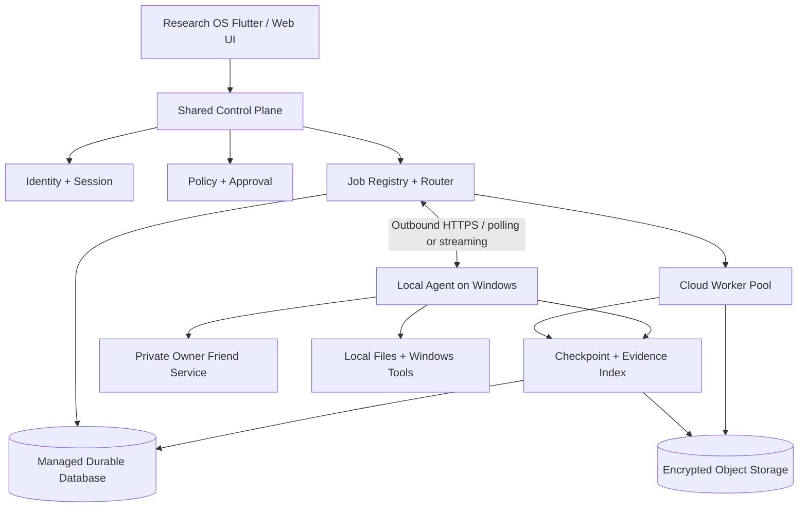

# Research OS Cloud + Local — Target Architecture

**Document ID:** ROS-CL-01  
**Revision:** 1.0-draft  
**Status:** Proposed; review required before implementation  
**Date:** 2026-11-03  
**Baseline SHA:** `63e863b6823e26d044ac6a524503c795a4bc9165`

## 01. Executive decision

Adopt a **shared control plane with separate Cloud and Local execution planes**.

Research OS remains one product and one authorization domain. A central control plane owns identity, policy, job records, routing decisions, durable checkpoints and evidence references. Execution is delegated to either cloud workers or an authenticated Local Agent according to the capabilities and data locality of each job stage.

This is a target design, not a claim that cloud routing or Azure deployment already exists.

## 02. Design goals

1. Continue eligible cloud work when the user's PC is shut down or disconnected.
2. Run local-only work against local files, Windows applications, installed tools and Owner Friend without exposing those services publicly.
3. Resume interrupted work without duplicate side effects.
4. Preserve user/owner isolation, approval gates, audit evidence and source provenance.
5. Support multiple local devices and cloud workers without binding durable state to one process.
6. Allow staged migration from the current local-first implementation.

## 03. Logical architecture

The diagram describes logical responsibilities. Exact transport, queue technology, hosting products and deployment topology remain subject to the Gaps and Decisions sections.

## 04. Responsibility boundaries

### 04.1 Shared Control Plane

The Control Plane is authoritative for:

- User and owner identity, session validation and revocation.
- Tenant/owner scoping and policy evaluation.
- Tool capability declarations and approval requirements.
- Job creation, execution-mode selection and assignment.
- Lease issuance, renewal, expiry and reclaim.
- Checkpoint metadata and source revision validation.
- Evidence references, audit history and release authority.
- Agent registration, heartbeat, capability and revocation.

The Control Plane must not assume that a Local Agent is online or that a local filesystem is mounted.

### 04.2 Cloud Execution Plane

Cloud workers may execute only stages whose inputs, credentials, tools and data are explicitly available and authorized in Cloud.

Examples:
- Repository analysis against authorized cloud APIs.
- Scheduled research and summarization over approved cloud sources.
- Build/test jobs in isolated workers.
- Durable job orchestration and checkpoint coordination.

Cloud workers must be stateless between claims. Durable job state belongs in managed storage, not a container's writable layer.

### 04.3 Local Execution Plane

The Local Agent is installed with the Windows Research OS distribution and runs under a restricted service identity.

It may:
- Access explicitly approved local folders and applications.
- Invoke installed local tools through an allow-listed capability registry.
- Connect to the local Owner Friend service over loopback.
- Execute Local-mode stages after receiving a signed/validated assignment.
- Upload only approved outputs, logs and evidence.

It must not:
- Expose Owner Friend or Windows service ports to the public internet.
- Accept arbitrary commands from an unauthenticated network peer.
- silently broaden folder or tool permissions.
- upload raw local data unless the job policy explicitly permits it.

### 04.4 Owner Friend

Owner Friend remains a private local capability behind the Local Agent in the initial hybrid design. Cloud workers call the Control Plane, not the Windows Friend loopback endpoint. Any future remote Friend capability requires a separate security design and explicit approval.

## 05. Execution-mode routing

Each job declares one of the following modes:

| Mode | Meaning | PC required? | Routing |
|---|---|---:|---|
| `CLOUD` | All required inputs and tools are cloud-accessible | No | Cloud worker pool |
| `LOCAL` | Requires local files, Windows tools or local runtime | Yes | Eligible Local Agent |
| `HYBRID` | Contains both cloud and local stages | Only for local stages | Stage-by-stage router |
| `AUTO` | Router chooses only from declared capabilities and policy | Depends on chosen stage | Policy-constrained routing |

AUTO must never mean “send local data to Cloud by default.” If locality or data classification is unknown, hold the stage for clarification or local execution.

When a Local Agent is offline:
- Cloud-only stages may continue.
- Local-only stages move to `WAITING_FOR_LOCAL_AGENT`.
- Hybrid jobs preserve completed stages and wait at the local boundary.
- No local stage is marked complete merely because its lease expired.

## 06. Trust boundaries and security

1. **Client to Control Plane:** TLS, authenticated sessions, CSRF/origin protections where browser cookies are used, rate limits and session revocation.
2. **Cloud worker to Control Plane:** workload identity or short-lived scoped credentials; no long-lived owner token embedded in images.
3. **Local Agent to Control Plane:** outbound TLS only, device identity, short-lived enrollment/refresh credentials, capability-scoped assignments and revocation.
4. **Local Agent to Friend:** loopback/private IPC only; validate owner, profile and session context.
5. **Storage:** encryption in transit and at rest; owner-scoped authorization on every read/write; secrets held in a managed secret store.
6. **Artifacts:** content hashes, malware/type checks where applicable, size limits, retention policy and signed provenance metadata.
7. **Approvals:** side-effecting operations require explicit policy/approval evidence at execution time, not merely at job creation.

Never store API keys, OAuth client secrets, access tokens or enrollment secrets in source control, build artifacts, plain logs or job payloads.

## 07. Durable state and data placement

| Data class | Target location | Notes |
|---|---|---|
| Identity, sessions, revocation | Managed relational store / identity provider | Preserve owner isolation and revocation semantics |
| Job and lease state | Managed transactional database or durable queue | Must support concurrent workers and conditional lease updates |
| Checkpoint metadata | Managed relational store | Keep source SHA, task lineage and evidence references |
| Large artifacts | Encrypted object storage | Store hashes and access policy in metadata |
| Audit/evidence records | Append-oriented durable store + object references | Retention and tamper-evidence required |
| OAuth credentials | Secret store or encrypted owner-scoped credential vault | Never move plaintext tokens into shared logs |
| Local-only files and application state | Local data directory | Remain local unless an approved transfer is part of a job |

Existing local JSON/JSONL files are not automatically cloud-compatible databases. Migration requires inventory, schema mapping, owner scoping, encryption, concurrency analysis, export/import verification and rollback.

## 08. Proposed Azure reference mapping (not provisioned)

| Capability | Candidate Azure service | Selection condition |
|---|---|---|
| API / Control Plane | Azure Container Apps | Confirm runtime, ingress, scaling and private networking needs |
| Container images | Azure Container Registry | Image signing, scanning and immutable tags |
| Relational state | Azure Database for PostgreSQL Flexible Server | Transactional lease/job semantics and backup/restore |
| Artifacts | Azure Blob Storage | Private containers, lifecycle, versioning and encryption |
| Secrets | Azure Key Vault | Workload identity and rotation |
| Monitoring | Azure Monitor / Application Insights | Correlation IDs, traces, metrics, alerting and retention |
| Async messaging | Azure Service Bus or database-backed queue | Choose after delivery/idempotency and ordering requirements are measured |

These are candidates, not a final bill of materials. Region, data residency, subscription, budget, network topology and service availability must be confirmed before provisioning. Do not provision resources as part of this documentation PR.

## 09. Container and runtime requirements

The current `research-os/Dockerfile` copies `research-os/app` and `research-os/service` and starts `app/main.py`. It is therefore not evidence of a production image for `tools/research_os_api/server.py`.

A production API image must be designed separately and must:
- Install pinned dependencies with failure-fast behavior.
- Run as a non-root user where supported.
- expose only the intended API port.
- use health/readiness checks.
- externalize durable state and secrets.
- emit structured logs and correlation IDs.
- pin base images and produce an SBOM and vulnerability scan.
- avoid copying local user data, tokens, developer workspaces or private keys into the image.

## 10. Availability and recovery model

- Job claims use expiring leases with unique lease tokens.
- A worker may acknowledge, renew or fail only while it owns the current lease.
- Expired leases may be reclaimed by another eligible worker.
- Every externally visible side effect must use an idempotency key or a reconciliation mechanism.
- Checkpoints are written after durable stage boundaries and validated against the current source SHA and policy.
- Reconnects must not cause the Local Agent to repeat a completed side effect.
- A dead-letter or terminal-failure path must preserve diagnostic evidence without leaking secrets.

Suggested job states are specified in document 02.

## 11. Phased rollout

| Phase | Scope | Exit criteria |
|---:|---|---|
| 0 | Architecture and gap audit | Documents reviewed; decisions and unknowns recorded |
| 1 | Versioned API/job/agent contracts | Schema tests, compatibility and threat model approved |
| 2 | Production API container | Image starts, health checks pass, no local data dependency |
| 3 | Cloud foundation | Network, identity, database, object storage, secrets, backups and monitoring verified |
| 4 | Cloud-only execution | Durable jobs, leases, idempotency and recovery pass |
| 5 | Local Agent outbound channel | Enrollment, revocation, heartbeat, capability policy and offline behavior pass |
| 6 | Hybrid stage orchestration | Cloud/local transitions and checkpoint recovery pass |
| 7 | Data migration (only if required) | Inventory, parity, restore rehearsal and explicit approval |
| 8 | Production release | Security, load, backup restore, observability and release gates pass |

## 12. Decisions still required

- Azure subscription, tenant, region and data residency.
- Budget ceiling and expected concurrency/throughput.
- Whether PostgreSQL is the canonical transactional store or an existing managed store can satisfy the contract.
- Queue/messaging choice after testing current SQLite semantics and load.
- Local Agent enrollment UX, device identity lifecycle and supported Windows versions.
- Local data classification, upload consent and retention.
- OAuth credential ownership, refresh, revocation and migration strategy.
- Recovery objectives (RPO/RTO), retention and backup frequency.
- Whether Render remains a temporary environment or is retired after Cloud cutover.

## 13. Acceptance criteria for architecture approval

- [ ] Cloud-only work can be defined without a Local Agent.
- [ ] Local-only work cannot be dispatched to a Cloud worker.
- [ ] Hybrid jobs stop safely at local boundaries when the PC is offline.
- [ ] Owner identity, policy and evidence are shared without sharing local filesystem access.
- [ ] No public inbound route to Owner Friend is required.
- [ ] Durable state survives worker/container restart.
- [ ] Retry and reclaim behavior is idempotent and lease-protected.
- [ ] Existing local data is preserved until a separate migration is approved.
- [ ] Every proposed cloud service is tagged as candidate, not provisioned.
